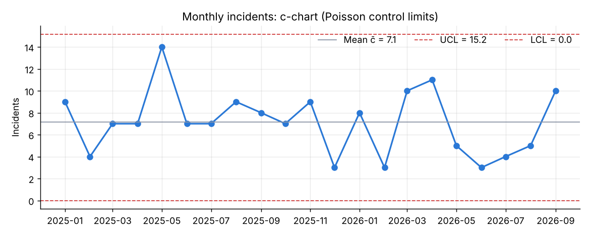
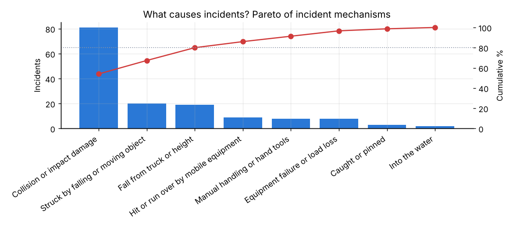
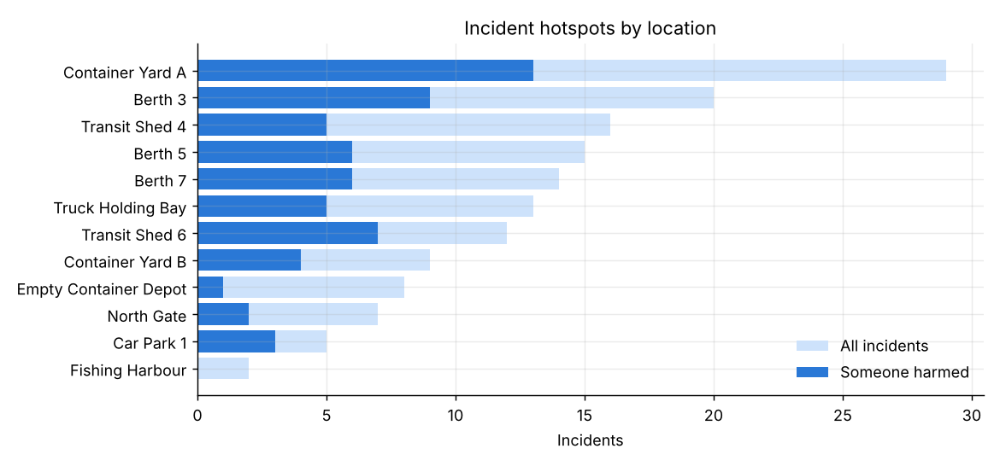
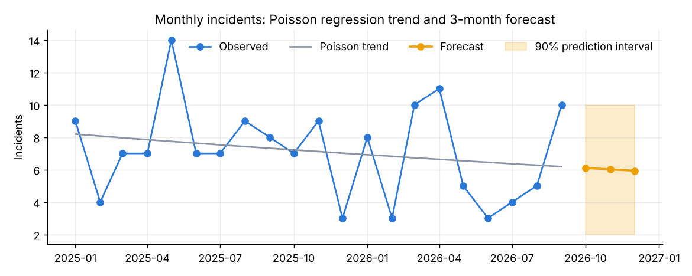
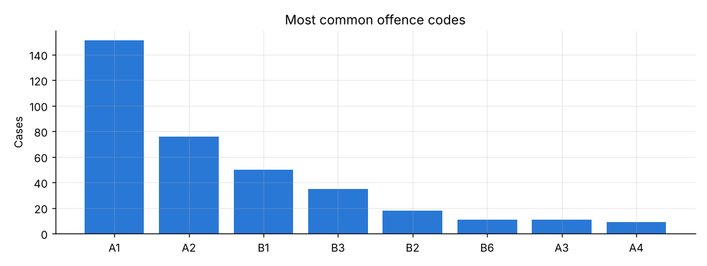

# Port Incident Analysis

**Statistical analysis of port accident and offence records: control charts, Pareto analysis, rate tests and Poisson regression forecasting.**

This is the analytics companion to my [Port Safety Intelligence Dashboard](https://github.com/kobbyRollz/port-safety-intelligence-dashboard). The dashboard shows *what* is happening. This project asks whether changes are real or just noise, and what to expect next.

> **Data is synthetic.** It comes from the dashboard's demo generator, so no real people or incidents appear here. The methods are the ones I apply to the real registers in my work as a Fire & Safety Officer.

## Questions and findings

### 1. Is the incident rate stable, or are some months unusual?
A **c-chart** (Shewhart control chart for counts, with Poisson limits c̄ ± 3√c̄) shows a mean of **7.1 incidents a month**, with an upper control limit of 15.2. No month falls outside the limits: the process is "in control", so a bad month on its own is not evidence that something changed.



### 2. Did 2026 get safer than 2025?
2025 averaged 7.6 incidents a month and 2026 so far averages 6.6, a **rate ratio of 0.86**. An exact conditional Poisson test gives **p = 0.41**. The drop is not statistically significant yet, so it should not be reported to management as an improvement.

### 3. What causes most incidents?
A **Pareto analysis** shows that **3 of 8 mechanisms account for 80% of all incidents**: collisions, being struck by falling or moving objects, and falls from trucks or heights. That is where prevention effort pays off most.



### 4. Where, and who?
The top 3 locations hold **43% of all incidents**, with Container Yard A the highest. Among people harmed, dockers are the largest known group (28%). But **48% of injury records do not state who was hurt**, which is a data-quality gap worth fixing.



### 5. What should we expect next quarter?
A **Poisson regression** with a linear time trend estimates a −1.4% monthly change (p = 0.30; a negative-binomial check for mild overdispersion, φ = 1.2, gives the same conclusion). The forecast for Oct–Dec 2026 is **about 6 incidents a month (90% prediction interval 2–10)**. A month above 10 would be a signal worth investigating.



### 6. Do corrective actions change anything?
**77% of incidents were closed with advice or a toolbox talk only.** Only 17% led to a physical or procedural control. Under the hierarchy of controls (eliminate, substitute, engineer, administer, then PPE), that is the weakest kind of response.

### 7. Fines
77% of fines are paid (43% on the same day), 13% are outstanding and 6% are under appeal. Repeat offenders account for 20% of cases.



## Methods

| Question | Method |
|---|---|
| Unusual months | c-chart (statistical process control), Poisson 3σ limits |
| Year-on-year change | Exact conditional test for two Poisson rates (binomial) |
| Main causes | Pareto analysis (80/20 rule) |
| Trend and forecast | Poisson GLM with log link; negative-binomial robustness check; Poisson prediction intervals |

## Run it

```bash
pip install -r requirements.txt
python analysis.py        # prints the numbers above and redraws figures/
```

## Author
**Kwabena Asiedu Akyeampong**: Fire & Safety Officer · MSc Applied Mathematics (GIMPA) · BSc Statistics (KNUST)
[LinkedIn](https://linkedin.com/in/kwabena-akyeampong)
